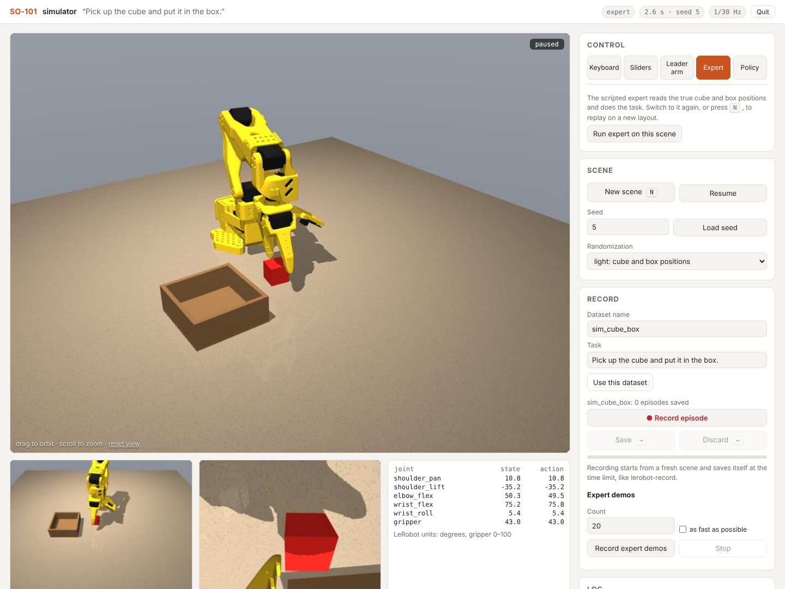

# SO-101 simulator

A MuJoCo simulation of our lab task, *"Pick up the cube and put it in the box."*,
on a single SO-101 follower. It runs on **Windows, macOS and Linux** and does three
jobs:

1. **Collect training data.** A scripted expert, keyboard teleop, or the real
   SO-101 leader arm on USB records demonstrations as LeRobot datasets with the
   same features as `hardware/so101_lab.sh`: `observation.state` and `action` with
   the six `<joint>.pos` names, `observation.images.camera1` (front) and
   `camera2` (wrist) at 640×480, 30 fps, robot type `so101_follower`.
   `lerobot-train` reads them like a real dataset.
2. **Measure task success without the arm.** `eval` runs any LeRobot checkpoint
   (SmolVLA, π0/π0.5, ACT) in closed loop over fixed, seeded layouts and writes a
   JSON record with a Wilson 95% interval.
3. **Put the Jetson's latency into that measurement.** Chunk latency is injected
   in simulated time, taken from our harness records in `results/`. So the success
   rate is the one the policy would get at the Orin Nano's latency, measured on
   any laptop, and the observation staleness the abstract talks about is reported
   per action.

It also closes an open item from the 2026-09-28 meeting: RoboTwin 2.0 is
dual-arm and Linux-only, Isaac Sim does not run on macOS, and this is a single
SO-101 that runs everywhere.

## Start it

You need Python 3.12 the first time; the launcher builds a private environment
in `.venv/` next to it (about 2 GB, a few minutes) and reuses it afterwards.

| System | How |
| --- | --- |
| Windows 10/11 (64-bit) | Double-click `run_app.bat`. Python from [python.org](https://www.python.org/downloads/), with "Add python.exe to PATH" ticked |
| macOS 13+ on Apple Silicon | Double-click `run_app.command`. Python via `brew install python@3.12` or python.org |
| Linux | `./run_app.sh` |
| Intel Mac | Works without LeRobot: simulator and teleop yes, recording and policy eval no. PyTorch no longer ships for Intel Macs |

A browser tab opens at `http://127.0.0.1:8765/`. The simulator itself runs in the
terminal window; closing that window stops it. Saved episodes are safe whenever
it stops, because the dataset is finalized after every episode.

If macOS says `run_app.command` cannot be opened (common after downloading a
zip instead of cloning), right-click it and choose Open once, or run
`chmod +x run_app.command run_app.sh` in Terminal.

To check a computer before a session:

```bash
python -m so101_sim check          # versions, a rendered test image, 3 expert episodes
```

Every launcher option passes through, e.g. `run_app.bat --randomize full --dataset my_demos`.
With the environment active (`.venv\Scripts\activate` or `source .venv/bin/activate`),
`python -m so101_sim <command> -h` lists all options.

## The app



The big view orbits with the mouse. Below it are the two images a policy sees and
the joint readout in LeRobot units.

**Control modes**

| Mode | What drives the arm |
| --- | --- |
| Keyboard | You steer the jaws: <kbd>W</kbd>/<kbd>S</kbd> forward/back, <kbd>A</kbd>/<kbd>D</kbd> left/right, <kbd>R</kbd>/<kbd>F</kbd> up/down, <kbd>T</kbd>/<kbd>G</kbd> tilt, <kbd>Q</kbd>/<kbd>E</kbd> wrist roll, <kbd>Space</kbd> opens or closes the gripper (the first press opens it fully), hold <kbd>Shift</kbd> for fine moves. Inverse kinematics turns that into joint targets. Far out or high up the wrist cannot point the jaws straight down; they then tilt as far as the joint allows, and the page shows the tilt they have |
| Sliders | One slider per joint |
| Leader arm | Your real SO-101 leader on USB, through LeRobot's own driver. Calibrate it on this computer once with `lerobot-calibrate --teleop.type=so101_leader --teleop.port=PORT --teleop.id=ID`. Ports look like `COM3` on Windows and `/dev/tty.usbmodem…` on macOS; `lerobot-find-port` tells you which |
| Expert | The scripted expert does the task on the current layout |
| Policy | A checkpoint drives the arm with a chosen latency, sync or async |

The header shows the simulator's rate. Rendering is nearly all of the cost
(about 14 ms per camera image on an M-series Mac, mostly the arm's meshes, not
the resolution), so `camera1` and `camera2` refresh in the page at 10 Hz unless
you are recording or running a policy, and the 3D view drops to 10 Hz while
recording. Recordings are in simulated time, so a slow computer only makes
keyboard, expert and policy episodes take longer. With the leader arm it changes
the data: you move in real time, so below 30 Hz your motion is stored sped up, and
the log says so.

**Real follower.** The *Real follower* panel connects a real SO-101 follower on
USB and mirrors the simulated arm on it: whatever drives the simulator (keyboard,
sliders, the leader arm, the expert or a policy) drives the real arm too. With the
leader arm as the control mode this is teleop through the simulator. The follower
first moves to the simulated pose at 1° per step (about 30°/s), and again after a
new scene; then it follows at most 3° per step, as `MAX_STEP` in the lab script
(`--follower-max-step` changes it). It waits while *as fast as possible* is on, and
a serial error stops the mirror without stopping the app. Calibrate the follower
on this computer once with `lerobot-calibrate --robot.type=so101_follower
--robot.port=PORT --robot.id=ID`. Stopping the mirror turns its torque off, as
LeRobot does, so the arm goes limp: support it or bring it to rest first. The real
arm does not feed back into the simulator, so the cube it would push stays in the
simulator only. Not yet tried on the real arm.

**Recording** works like `lerobot-record`: *Record episode* starts from a fresh
layout, <kbd>→</kbd> saves, <kbd>←</kbd> discards, and an episode saves itself at
the time limit (20 s). *Record expert demos* records N successful expert demos in
a row; tick *as fast as possible* to skip real-time pacing. Datasets go to
`~/.cache/huggingface/lerobot/local/<name>` (on Windows
`%USERPROFILE%\.cache\huggingface\lerobot\local\<name>`), as on the Jetson.

## From demos to a success rate

**1. Generate demos.** Headless and much faster than real time on a laptop GPU:

```bash
python -m so101_sim generate --name sim_cube_box --episodes 200 --randomize full
```

Layout seeds start at 0 and each episode's seed and start pose are logged in
`meta/so101_sim_episodes.jsonl`. Only successful episodes are kept. The expert
succeeded on all 3,100 layouts checked from the home pose (seeds 0–1399 at
`light`, 0–1399 and 100000–100299 at `full`), and on all 800 checked from random
start poses (seeds 0–299 at `light`, 0–299 and 100000–100199 at `full`). Over a
far box, or above a far cube, it tilts the jaws a little off vertical, because
pointing them straight down there needs more `wrist_flex` than the joint has.

**2. Train on the workstation.** Copy the dataset folder to the RTX 4090 machine,
then fine-tune as with real data, for example SmolVLA:

```bash
lerobot-train --policy.path=lerobot/smolvla_base \
  --dataset.repo_id=local/sim_cube_box --dataset.root=/path/to/sim_cube_box \
  --policy.device=cuda --policy.push_to_hub=false \
  --batch_size=64 --steps=20000 --output_dir=outputs/train/smolvla_sim
```

The camera keys are already `camera1` and `camera2`, the names `smolvla_base`
expects, so no renaming is needed.

LeRobot decodes the videos with torchcodec, which needs FFmpeg's shared libraries
on the machine. If `lerobot-train` stops with `Could not load libtorchcodec` (seen
on a Mac without FFmpeg), add `--dataset.video_backend=pyav`.

**3. Evaluate with the Jetson's latency.**

```bash
# p50 and spread of chunk latency from a harness record on the board
python -m so101_sim eval --policy outputs/train/smolvla_sim/checkpoints/last/pretrained_model \
  --episodes 50 --num-steps 5 \
  --latency-from ../../results/20261026-223659_maxn-pinned-smolvla-1cam-5step.json

# or sweep latency to get the success-versus-latency curve
python -m so101_sim eval --policy … --episodes 50 --latency-ms 0,250,500,750,1000,1250
```

Records go to the repo's `results/` as `<time>_sim-eval_<name>_<mode>_<latency>ms.json`,
where `<name>` is the training run and checkpoint (`smolvla_sim-last`), with the success count and Wilson interval, per-episode results, the mean and
p95 observation staleness, the fraction of stalled steps and the git commit.
Evaluation layouts start at seed 100000, so they never repeat a training layout.

`--policy expert` runs the scripted expert through the same latency machinery.
It is a plumbing check, not a result: the expert plays an open-loop plan, so
staleness cannot hurt it the way it hurts a policy that reacts to the camera.

### Sync and async, and what latency costs

| | sync (what `lerobot-record` does now) | async (LeRobot async inference) |
| --- | --- | --- |
| When a chunk is planned | when the queue is empty | when `--threshold` × chunk is left |
| While it is computed | the arm holds its last target | the old chunk keeps playing |
| When it arrives | played in full | actions for steps already past are dropped |
| Cost of latency | pauses, so episodes take longer | stale observations; stalls if the queue runs dry |

As a first look with the expert stand-in over 12 layouts: at the pinned
SmolVLA one-camera, five-step latency (488 ms) async succeeds 12/12 with 7%
stalled steps. At the unpinned two-camera, ten-step latency (1,129 ms) and
threshold 0.5, the queue runs dry 58% of the time and async drops to 10/12,
while sync stays at 12/12 but takes 30% longer. Raising `--threshold` above
latency ÷ chunk duration (here 1.13 s ÷ 1.67 s ≈ 0.68) is the obvious knob.

## Shared datasets

Datasets and checkpoints are too big for git (several files are over GitHub's
100 MB limit), so they live on Hugging Face. Each entry names the commit of this
repo that generated it; check that commit out to regenerate it exactly.

| Dataset | Made with | Contents |
| --- | --- | --- |
| [`duylam1407/so101_sim_cube_box`](https://huggingface.co/datasets/duylam1407/so101_sim_cube_box) (private) | commit `6e41556`, `python -m so101_sim generate --name sim_cube_box --episodes 200 --randomize full` | 200 expert episodes, 55,067 frames, 30 fps, seeds 0–199, default start spread; 200/200 expert successes; 662 MB. Hub revision `d926fb5`, tag `v3.0` |

`lerobot-train` downloads a dataset by its id, so no copying is needed. Log in
once with `hf auth login` using an account that can read the repo, then:

```bash
lerobot-train --policy.path=lerobot/smolvla_base \
  --dataset.repo_id=duylam1407/so101_sim_cube_box \
  --policy.device=cuda --policy.push_to_hub=false \
  --batch_size=64 --steps=20000 --output_dir=outputs/train/smolvla_sim
```

Training runs on it so far:

| Run | Where | Settings | Status |
| --- | --- | --- | --- |
| `act_sim` | M1 Pro laptop, MPS | ACT, `chunk_size` and `n_action_steps` 50, batch 8, 20k steps, `--dataset.video_backend=pyav` | in progress, about 1 s/step |
| `smolvla_sim` | RTX 4090 | the command above | not started |

## Matching the real arm

**Units.** LeRobot 0.4.4 and 0.5.1 both default the SO-101 to `use_degrees=True`:
five joints in degrees from the middle of each calibrated range, gripper 0–100.
The Menagerie model puts its joint zeros at mid-range too, so arm joints map as
plain degrees, and the gripper maps its simulated range onto 0–100 with 0
closed. Both are assumptions until checked once against the real follower: put it
in a pose, compare its readings with the simulator's joint readout in the same
pose, and if a joint is mirrored or offset, write a joint map rather than editing
code:

```json
{"sign": [1, 1, 1, 1, 1], "offset_deg": [0, 0, 0, 0, 0], "gripper_closed": 0, "gripper_open": 100}
```

then pass `--joint-map my_arm.json` to any command.

**Cameras.** `camera1` sits 62 cm in front of the base and 42 cm up, aimed at the
table 20 cm in front of the base, with a 52° vertical field of view (a Brio at
78° diagonal, cropped to 4:3). Measure the stand in ENG276 and pass
`--camera1-pos X,Y,Z --camera1-target X,Y,Z` (metres; x forward from the arm
base, y to its left, z up). `camera2` is the wrist camera on Menagerie's camera
mount.

**Episodes** start near a raised home pose with the jaws about 16 cm over the
table (`--home` changes it). The real arm's folded rest pose puts the jaws inside
the area where cubes spawn. On the real arm an episode starts wherever the arm
is, so at `light` and `full` each episode's start pose strays from home by up to
30° on `shoulder_pan` and `wrist_roll`, 15–20° on the other joints and 20 on the
gripper, redrawn if the jaws come within 10 cm of the table or the arm touches
the cube or box. `--start-spread 2` doubles that (the expert still succeeded on
150 of 150 layouts), and `--start-spread 0` or `--randomize none` starts every
episode at home. A seed gives the same layout at any spread.

**Servo limits.** The gripper gets half the arm servos' torque, because
LeRobot's follower writes `Max_Torque_Limit = 500` (50%) to the gripper.
`--max-step-deg 3` mirrors the lab script's `MAX_STEP`.

## Limits worth knowing

- **Sim-to-real.** The renders are clean CAD colours on a plain table. A policy
  trained only on simulated images will not transfer to the real cameras as is.
  Use simulated demos for the simulated success budget, and for real-arm runs
  train on real demos or mix the two.
- **Servo gains** are Menagerie's, not identified against our servos. The source
  models disagree by 56× on the position gain. If simulated success matters for
  the paper, fit them to a few recorded real trajectories first.
- **SmolVLA in the loop** goes through the same `predict_action_chunk` path that
  LeRobot's async policy server uses, and was exercised here with an ACT
  checkpoint. SmolVLA itself has not been run in this simulator yet.

## Layout

```text
so101_sim/
  env.py          scene, physics, cameras, randomization, success check
  units.py        sim radians <-> LeRobot degrees and gripper 0-100
  ik.py           5-DoF inverse kinematics (position + pitch, roll set directly)
  expert.py       scripted pick-and-place
  recorder.py     LeRobot dataset writer
  generate.py     headless expert demo generation
  policy_eval.py  latency model, chunk executor, closed-loop evaluation
  leader.py       real SO-101 leader arm over USB
  follower.py     mirror the simulated arm on a real SO-101 follower over USB
  app/            local web server and the browser page
  assets/so101/   MuJoCo Menagerie robotstudio_so101 (Apache-2.0) + the task scene
tests/            pytest; CI runs them on Windows, macOS and Linux
```

`python -m pytest` runs the tests. `.github/workflows/so101-sim.yml` runs them,
the launchers and a rendering check on all three systems.

## Credits

The arm model is [MuJoCo Menagerie](https://github.com/google-deepmind/mujoco_menagerie)'s
`robotstudio_so101` (commit `370c439`, Apache-2.0, licence in `assets/so101/LICENSE`),
derived from The Robot Studio's SO-ARM100 `so101_new_calib` model.
